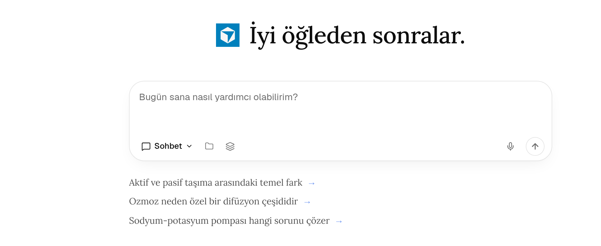
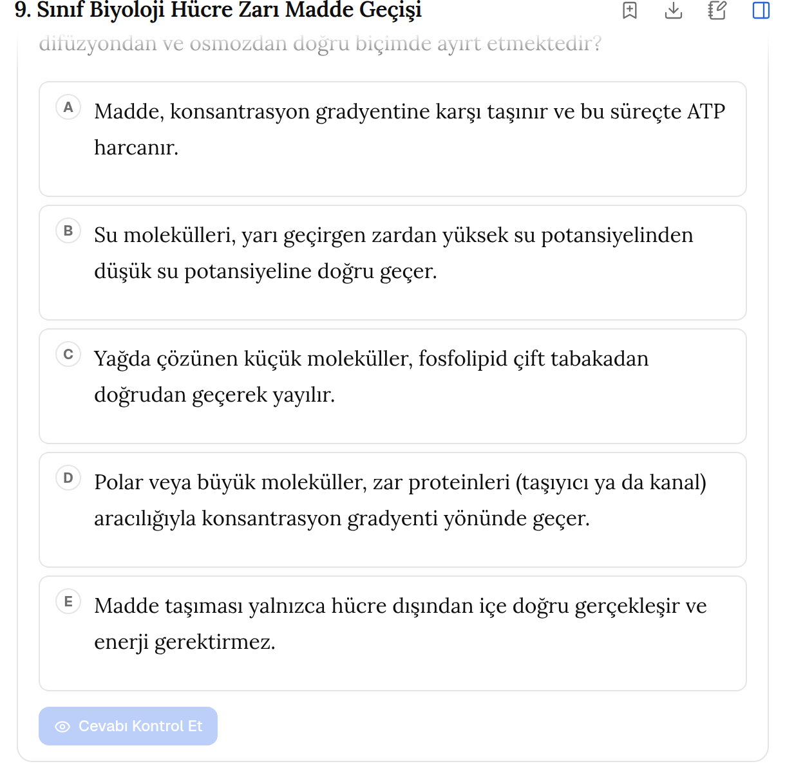
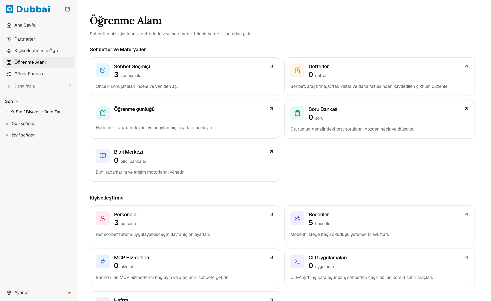

# Dubbai: Yapay Zekâ Destekli Kişisel Öğretmen

**Ders kitabına dayalı konu anlatımı, adım adım soru çözümü, YKS ve LGS tarzı testler.**

Tam sürüm **[Dubba](https://dubba.com.tr/dubbai)** platformunda.

---

Dubbai, Türkiye'deki öğrenciler için geliştirilen yapay zekâ öğrenme asistanıdır.
MEB müfredatına uygun anlatır, soruyu adım adım çözer, eksik konuları tespit eder
ve YKS/LGS formatında çalışma soruları hazırlar. Arayüzü ve cevapları tamamen
Türkçedir.

  

## Neler yapar?

| Özellik | Öğrenciye faydası |
| --- | --- |
| **Konu anlatımı** | Soru-cevap şeklinde, ders kitabına dayanarak ve kaynak göstererek anlatır. |
| **Adım adım soru çözümü** | Metin ya da fotoğraf olarak verilen soruyu adım adım çözer, sağlamasını yapar. |
| **YKS/LGS tarzı test** | Seçilen konudan beş seçenekli (A–E), açıklamalı test soruları hazırlar. |
| **Ustalık yolu** | Konuyu parçalara böler, anlaşılmayan yeri tekrar ettirir. |
| **Sokratik mod** | Cevabı söylemek yerine soru sorarak öğrenciyi düşündürür. |
| **Görselleştirme** | Grafik, şema ve animasyonla konuyu canlandırır. |
| **Kişisel hafıza** | Öğrencinin güçlü ve zayıf olduğu konuları hatırlar, çalışmayı ona göre yönlendirir. |

  

  

## Kimler için?

- **Öğrenciler:** 9–12. sınıf ders konuları, TYT/AYT ve LGS hazırlığı
- **Öğretmenler:** konu anlatımı desteği, soru ve test hazırlığı

## Nasıl kullanılır?

Dubbai, Dubba hesabıyla kullanılır:

1. [dubba.com.tr](https://dubba.com.tr) adresinden ücretsiz hesap oluştur.
2. [Dubbai](https://dubba.com.tr/dubbai) sayfasına git.
3. Merak ettiğin konuyu sor ya da çözemediğin sorunun fotoğrafını yükle.

## Durum

Dubbai aktif olarak geliştiriliyor ve Dubba platformunda kademeli olarak
yayına alınıyor. Yeni özellikler ve duyurular için bu sayfayı takip edebilirsin.

## İletişim

Öneri ve sorular için [Issues](https://github.com/nzengi/dubbai/issues)
sayfasını kullanabilir ya da [dubba.com.tr](https://dubba.com.tr) üzerinden
bize ulaşabilirsin.

---

© 2026 Dubba. Tüm hakları saklıdır. Bu depo yalnızca tanıtım amaçlıdır;
Dubbai'nin kaynak kodu bu depoda yer almaz.
